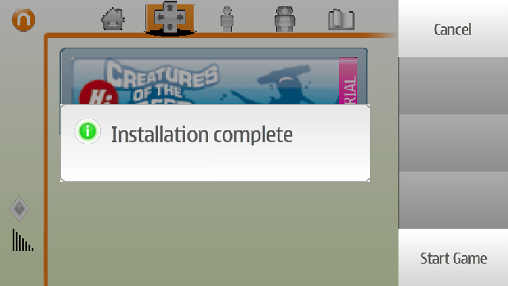

# Play N-Gage 2.0 on Symbian^3

An adaptation of Nokia N97's N-Gage 2.0 for hacked Symbian^3 / Belle phones,
with touchscreen controls for devices without a physical keypad.
Current version: **1.30(1554)**.

**Hooked: Creatures of the Deep** has been tested on a **Nokia 808 Belle FP2**,
with working graphics, sound, virtual controls and hardware volume buttons.
Other games and phone models have not all been tested.

## Features

- Keep using the original **Games** app to install games and launch them from their covers.
- Use translucent virtual controls: a five-way pad on the left and R / A / B / L on the right. The upper-left button hides or shows the controls.
- Enjoy game graphics and sound, with volume adjustment using the phone's volume buttons.
- Touch controls start with each game and exit when that game closes. Switching to another app keeps them available when you return.
- No extra Games(Touch) launcher icon. The current version does not write diagnostic logs.
- The compatibility files are part of the N-Gage package, so the phone lists a single installed item.

The adaptation builds on the N97 software, adding display, audio and touch-control
compatibility for newer phones. It requires no ROM flashing or changes to game files.

## Download and play

Your phone must already be hacked, with **Install Server** and **Open4All** enabled.

1. Open the [build downloads page](https://github.com/yeatse/ngage-installer-symbian3/actions/workflows/build.yml), select the latest successful build, and download `ngage-installer-symbian3-unsigned` under **Artifacts** at the bottom. Extract the downloaded archive. A GitHub login is required to download artifacts.
2. Transfer **`ngage-installer-symbian3.sis`** to your phone and install it. No signing is needed. Use this file for ordinary phones.
3. Copy your `.n-gage` game files to **`E:\n-gage`** on the phone.
4. Open **Games**, install the game there, then select its cover to launch it.

To upgrade, exit Games, install the new package over the existing version, then
restart your phone. Games are not included; you must provide your own game files.

## Known issues

- **Reset Generation**: turn **Open4All** off before playing. With Open4All on,
  the game can show a black screen or exit with KERN-EXEC 3 at a random point
  during startup. Install Server can stay on. Open4All is only needed while
  installing.

## Screenshots

These screenshots were captured in EKA2L1 using an X7 ROM. The Nokia 808 results
above were confirmed through user testing on a physical phone.

**Game installation completed inside Games**

**In-game controls: R at the upper right, L at the lower right, and hide/show at the upper left**

## Further reading

- [How the adaptation works and what changed](docs/adaptation-summary.md)
- [Building from source](docs/build.md)
- [Validation, troubleshooting and development history](validation/README.md)

Nokia software and game imagery belong to their respective copyright holders
and are not covered by this project's MIT license.
