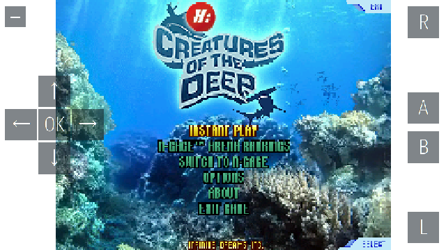

# Play N-Gage 2.0 on Symbian^3

Nokia N97's N-Gage 2.0 (version 1.30), adapted for hacked Symbian^3 and Belle
phones, with on-screen touch controls.

Tested on a **Nokia 808 Belle**: every game tested so far runs.

## Before you start

- Your phone must be hacked, with **Install Server** enabled and **Open4All** disabled.
- Games are not included. You need your own `.n-gage` game files.

## Install

1. Download **`ngage-installer-symbian3.sis`** from the
   [latest release](https://github.com/yeatse/ngage-installer-symbian3/releases/latest).
2. Copy it to your phone and install it. No signing is needed.
3. Copy your `.n-gage` game files to **`E:\n-gage`**.
4. Open **Games**, install a game there, then tap its cover to play.

To upgrade, close Games, install the new package over the old one, then restart
the phone.

## Controls

- A five-way pad is on the left; R, A, B and L are on the right.
- The pad has eight directions: touch between two arrows for a diagonal, and slide
  your thumb to change direction without lifting it.
- The button at the upper left hides or shows the controls.
- The button at the lower left switches the right side between A/B and a number keypad.
- The phone's volume keys change the game volume.

## More

- [How the adaptation works](docs/adaptation-summary.md)
- [Building from source](docs/build.md)
- [Validation and development history](validation/README.md)

Nokia software and game imagery belong to their respective owners and are not
covered by this project's MIT license.
